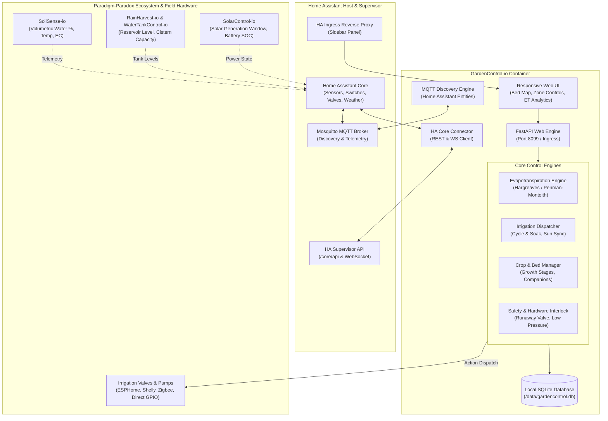

# GardenControl-io: System Architecture & Specification

---

## 1. Architectural Principles

1. **Local-First & Offline Resilient**: Runs 100% on the edge within Home Assistant. Requires zero cloud dependencies. If the internet goes down, irrigation schedules, cycle-and-soak routines, and safety watchdogs continue without interruption.
2. **Ecosystem Aware**: Designed to cooperate with sister systems:
   - **SoilSense-io**: Consumes localized soil moisture, soil temperature, and electrical conductivity (EC).
   - **RainHarvest-io / WaterTankControl-io**: Checks cistern levels before running high-volume irrigation. Halts pumps when cistern is critically low or switches to utility source.
   - **SolarControl-io**: Aligns energy-heavy booster pumps with peak solar generation windows to preserve battery energy.
3. **Biological Precision**: Moves beyond simple time-based watering to **Evapotranspiration (ET0)** and soil moisture depletion modeling. Supports deep root stimulation through intermittent cycle-and-soak.
4. **Safety Watchdog Guaranteed**: Software-enforced maximum runtimes per zone, pump dry-run lockouts, and simultaneous valve concurrency limits to prevent pressure dropouts.

---

## 2. Component Breakdown

### 2.1 Web & Ingress Layer (`app/main.py`, `app/static/`)
- Direct integration with Home Assistant Ingress via header path rewriting.
- Single Page Interface (SPA) with responsive canvas/SVG garden layout grid.
- Allows visual drag-and-drop crop placement, manual zone overrides, moisture heatmaps, and schedule configuration.

### 2.2 Core Irrigation & ET Dispatcher (`app/engine/irrigation.py`, `app/engine/et_calculator.py`)
- **Evapotranspiration Engine**: Computes daily crop water deficit:
  $$ET_c = K_c \times ET_0$$
  where $ET_0$ is reference evapotranspiration and $K_c$ is the crop coefficient based on current growth stage.
- **Cycle & Soak Sequencer**: Breaks an extended watering event (e.g. 30 minutes) into short pulses (e.g. 3 pulses of 10 min separated by 20 min soak intervals) to eliminate soil runoff and optimize percolation.
- **Weather Adaptation**: Automatic delay and reduction on precipitation events, high humidity, or forecasted rain.

### 2.3 Plant & Garden Bed Manager (`app/engine/plant_tracker.py`)
- Tracks raised beds, rows, containers, and orchard zones.
- Database of crop profiles: Germination period, days to maturity, companion compatibility matrix, nutrient demand.
- Calculates harvest forecast dates and succession planting recommendations.

### 2.4 Home Assistant & MQTT Integration (`app/engine/ha_client.py`, `app/engine/mqtt.py`)
- Automatic discovery for all garden zones as standard Home Assistant entities (`switch`, `valve`, `sensor`, `number`).
- Direct service calls to Home Assistant Core for triggering switches, pumps, and solenoids.

---

## 3. Distributed ESP32 Field Hardware Tier

GardenControl-io orchestrates field operations across diverse **ESP32** microcontrollers leveraging Wi-Fi, Ethernet, and Bluetooth Low Energy:

1. **Mission-Critical Valve Banks (Ethernet PoE)**:
   - Hardware: **Olimex ESP32-POE** or **WT32-ETH01** running ESPHome.
   - Zero Wi-Fi dropout risk, powered directly over Cat6 Ethernet.
   - Controls multi-channel optocoupled 24VAC/12VDC solenoid relays, pulse water flow meter, and line pressure transducers.
   - Autonomous on-board hardware watchdog timer (auto shut-off after 45m if network disconnects).
2. **Solar Microclimate & Bed Nodes (Wi-Fi Deep Sleep)**:
   - Hardware: **ESP32-C3 / ESP32-S3** with LiFePO4 or 18650 solar charging.
   - Measures capacitive volumetric soil moisture (VWC %), waterproof DS18B20 soil temperature, and BME280 ambient climate.
   - Switched sensor power rail eliminates capacitive probe corrosion and sustains months of battery life.
3. **Bluetooth Proximity Gateways (BLE Scanner)**:
   - Hardware: Standard **ESP32-WROOM** scanning local BLE advertisements from wireless garden beacons (e.g. Xiaomi Flora, SoilSense BLE, Inkbird) and proxying telemetry directly into Home Assistant.

Detailed schematics, pinouts, and firmware configurations are available in [docs/HARDWARE_ESP32.md](HARDWARE_ESP32.md) and [`firmware/`](../firmware/).
