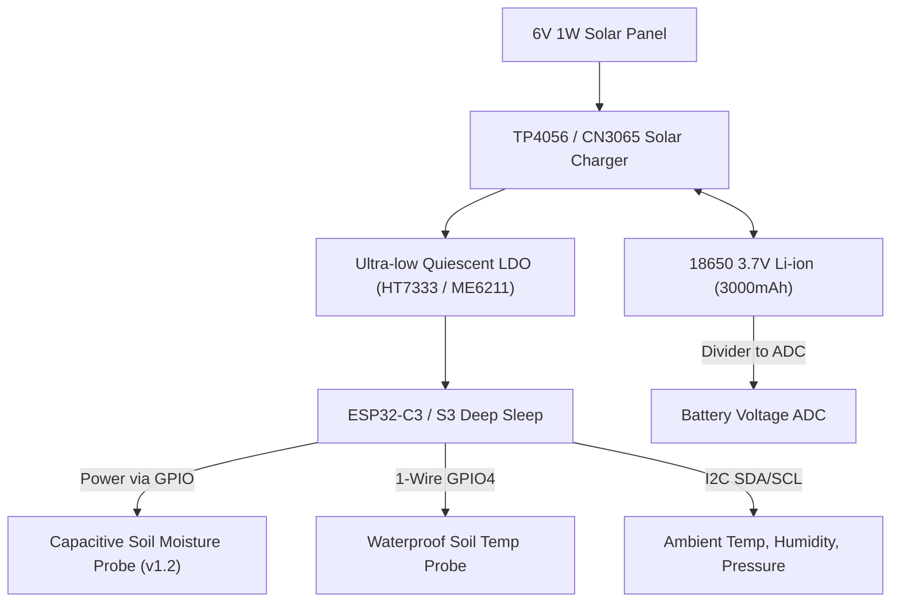

# GardenControl-io: ESP32 Hardware Integration Guide

This guide details the hardware blueprints, microcontroller selection, pinouts, and wiring schemas for deploying **ESP32** field devices across your garden and homestead.

---

## 1. Supported ESP32 Architecture Profiles

| Profile | Hardware Recommendations | Connectivity | Power Source | Primary Role |
| :--- | :--- | :--- | :--- | :--- |
| **Zone Manifold Controller** | Olimex ESP32-POE, WT32-ETH01, LilyGO T-ETH | Ethernet (PoE 802.3af) or Wi-Fi | 12V-24V DC / PoE | Multi-channel solenoid valves, master pump, flow meter |
| **Bed Microclimate Node** | ESP32-C3 / ESP32-S3 (Seeed Xiao, Adafruit Feather) | Wi-Fi 2.4 GHz | Solar + LiFePO4 / 18650 | Soil moisture (VWC), soil temp, BME280 ambient, deep sleep |
| **BLE Soil Gateway** | NodeMCU ESP32, ESP32-WROOM-32D | Wi-Fi + BLE 5.0 | 5V USB / Wall supply | Scans and ingests Bluetooth soil sensors (Mi Flora, Inkbird) |

---

## 2. Zone Valve Manifold (Ethernet PoE Controller)

```mermaid
flowchart LR
    PoE["PoE Switch (802.3af)"] -->|RJ45 Cat6| ESP["Olimex ESP32-POE"]
    ESP -->|I2C / GPIO| RelayBoard["8-Channel Optocoupled Relay Board"]
    ESP -->|Interrupt GPIO| FlowMeter["YF-B5 Hall Effect Pulse Flow Meter"]
    ESP -->|ADC 0-5V (Divider)| Pressure["0-1.2 MPa Water Pressure Transducer"]
    
    RelayBoard -->|24V AC / 12V DC| Valve1["Zone 1: Solenoid Valve"]
    RelayBoard -->|24V AC / 12V DC| Valve2["Zone 2: Solenoid Valve"]
    RelayBoard -->|24V AC / 12V DC| Valve3["Zone 3: Solenoid Valve"]
    RelayBoard -->|24V AC / 12V DC| MasterPump["Master Booster Pump Relay"]
```

### Key Wiring & Safety Protection:
1. **Flyback Diodes**: When driving 12V or 24V DC solenoids, always place a `1N4007` or `1N5819` Schottky flyback diode reverse-biased across the solenoid coil terminals to suppress inductive kickback voltage spikes.
2. **Optocoupler Isolation**: Use relay modules with optocoupler isolation (`PC817`) to keep electromagnetic switching noise away from the ESP32 logic pins.
3. **Pulse Flow Meter (Hall Effect)**:
   - Connect the signal pin to an interrupt-capable GPIO (e.g. `GPIO13`).
   - Use a 10kΩ pull-up resistor to 3.3V.
   - Sensor formula: $Q = \frac{\text{Pulses}}{\text{Factor}} \text{ (Liters)}$.
4. **Pressure Transducer (0-5V to 3.3V)**:
   - Use a resistive voltage divider ($2\text{k}\Omega / 3.3\text{k}\Omega$) or an I2C ADC (`ADS1115`) to protect the ESP32 3.3V ADC pin from 5V outputs.

---

## 3. Battery & Solar Bed Sensor Node (Wi-Fi Deep Sleep)



### Deep Sleep Power Optimization:
- **Duty Cycle**: Sleep for 30 minutes, wake up for 1.8 seconds.
- **Sensor Switched Power**: Power the capacitive sensor's $V_{cc}$ via an ESP32 GPIO pin (or P-channel MOSFET) instead of constantly powering it. This eliminates probe electrolysis and cuts idle current from 15mA down to < 15µA!
- **Deep Sleep Current**: With radio disabled and sensors unpowered, a well-designed ESP32-C3 draws under $20\mu A$ during sleep.

---

## 4. ESPHome Integration

GardenControl-io includes production-ready ESPHome configuration recipes in `firmware/esphome/`:
- [`firmware/esphome/valve_manifold_eth_poe.yaml`](../firmware/esphome/valve_manifold_eth_poe.yaml): Hardwired Ethernet valve bank with pulse flow counting and pressure monitoring.
- [`firmware/esphome/garden_bed_wifi_sensor.yaml`](../firmware/esphome/garden_bed_wifi_sensor.yaml): Low-power deep sleep solar bed sensor.
- [`firmware/esphome/ble_soil_tracker.yaml`](../firmware/esphome/ble_soil_tracker.yaml): Passive BLE scanner for Bluetooth garden probes.

Home Assistant automatically detects these nodes through native ESPHome API encryption (`noise.c`), making all sensors and switches instantly accessible to GardenControl-io.
